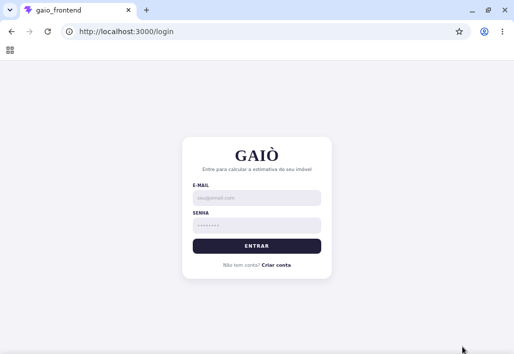
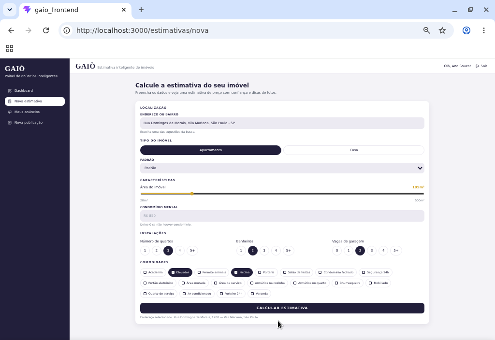

# GAIÒ - Frontend

Aplicação web do **GAIÒ** para calcular a estimativa de preço de imóveis e gerenciar anúncios, construída com **React + TypeScript + Vite**. Consome a API do backend (`../backend`).

## Telas da aplicação

### Login

Tela de acesso à aplicação, com campos de e-mail e senha e link para criação de conta.



### Nova estimativa

Formulário com localização, tipo do imóvel, área, condomínio, instalações e comodidades.



### Resultado da estimativa

Exibe o valor estimado, a faixa provável de mercado, a confiança da estimativa, os parâmetros analisados, os insights de mercado gerados pelo modelo e dicas para fotografar o imóvel.

## Visão geral

- Autenticação (login/cadastro/logout) com persistência de sessão
- Dashboard com análise de dados: sua carteira (números, funil com a conversão de cada etapa, atividade semanal, onde cada estimativa fica entre os anúncios do bairro e bairros mais estimados), panorama do mercado de SP com filtro de categoria e zona (m² por zona, bairros mais caros e baratos, amenidades, tipos e quartos; clicar num bairro abre o mapa nele) e a qualidade do modelo
- Exportação: estimativas e anúncios em CSV (com os insights, pronto para o Excel), relatório em PDF pela impressão do navegador e cada gráfico em PNG ou CSV; todo gráfico tem "Ver dados" com a tabela
- Calculadora de estimativa de preço integrada ao modelo de Machine Learning
- Autocomplete de endereço + detalhes por `placeId` (o bairro identificado é o que vai para o modelo)
- Mapa do mercado: clique em um ponto (ou use a localização do navegador) e veja os números dos anúncios do bairro
- Após calcular, a tela rola até o resultado; "Salvar" ou "Salvar e criar anúncio"
- Salvamento de estimativa na conta, histórico e exclusão de estimativas salvas
- Criação de anúncio a partir de estimativa salva (uma estimativa gera um único anúncio)
- Listagem, filtro, visualização, edição e exclusão de anúncios
- Perfil do usuário: edição de nome e e-mail e troca de senha
- Regra de publicação (`publicado=true` apenas quando `status=COMPLETO`)
- Estados de UX (loading, skeleton, empty state, toasts, disabled, confirmação)

## Stack

- React, TypeScript, Vite
- React Router, Axios
- Tailwind CSS, Lucide React (ícones)
- Leaflet + react-leaflet com mapas do OpenStreetMap (gratuito, sem chave de API)
- Recharts para os gráficos do dashboard
- oxlint (lint)

## Requisitos

- Node.js 22+ (o CI usa Node 24)
- npm 10+

## Como rodar localmente

A partir da raiz do repositório:

```bash
cd frontend
npm install
cp .env.example .env    # aponta VITE_API_URL para o backend (padrão http://localhost:8080)
npm run dev             # abre em http://localhost:5173
```

O backend precisa estar rodando (ver o `README.md` da raiz). A porta 5173 já está liberada no CORS do backend.

Outros comandos:

```bash
npm run lint    # oxlint
npm test        # testes (Vitest + Testing Library)
npm run build   # checagem de tipos + build de produção em dist/
```

### Demonstração sem o backend

`server/demo-server.mjs` serve o build e implementa, na mesma origem, os mesmos endpoints e formatos de JSON do backend, com valores de uma tabela fixa (não usa o modelo). Útil para apresentar as telas sem subir banco, backend e modelo (o panorama do dashboard vem de `server/mercado-resumo-demo.json`, exportado do serviço de ML):

```bash
npm run build
node server/demo-server.mjs    # http://localhost:3000 (PORT para trocar)
```

Usuário de demonstração já cadastrado: `demo@gaio.com` / `senha123`.

## Variáveis de ambiente

| Variável       | Obrigatória | Descrição                       |
| -------------- | ----------- | ------------------------------- |
| `VITE_API_URL` | Sim         | Base URL da API do backend GAIÒ |

## Estrutura de pastas

```txt
src/
  components/
    common/     componentes genéricos (Button, Input, Select...)
    domain/     componentes do negócio (EstimateCard, AddressAutocomplete...)
    layout/
  constants/    tipos de imóvel e comodidades (rótulo da tela <-> valor da API)
  contexts/
  hooks/
  layouts/
  pages/
  routes/
  services/     chamadas HTTP, uma por recurso da API
  types/        contratos de request/response da API
  utils/
server/         servidor de demonstração
docs/           imagens do README
```

## Endpoints consumidos

### Autenticação

- `POST /api/auth/registrar`
- `POST /api/auth/login`

### Endereços

- `GET /api/enderecos/autocomplete?input=<texto>`
- `GET /api/enderecos/detalhes?placeId=<id>`
- `GET /api/enderecos/reverso?lat=<lat>&lon=<lon>` (mapa)

### Mercado

- `GET /api/mercado/bairro?nome=<bairro>` (mapa e dashboard; precisa do serviço de ML ligado)
- `GET /api/mercado/resumo` (dashboard; precisa do serviço de ML ligado)

### Estimativas

- `POST /api/estimativas/calcular` (sem autenticação)
- `POST /api/estimativas` (salvar; o front exige login)
- `GET /api/estimativas` (com autenticação; só as estimativas do usuário)
- `GET /api/estimativas/{id}` (com autenticação; só do próprio usuário)
- `DELETE /api/estimativas/{id}` (com autenticação; bloqueado se a estimativa tiver anúncio)

O corpo de `calcular` e de `parametros` (em salvar) leva `bairroOuCep`, `areaM2`, `quartos`, `banheiros`, `vagasGaragem`, `categoria`, `tipo`, `condominio` e `amenidades` (só as marcadas, ex.: `{ "piscina": true }`). Os valores aceitos de `categoria` e `tipo` estão em `src/constants/imovel.ts`.

### Anúncios

- `POST /api/anuncios` (com autenticação)
- `GET /api/anuncios` (com filtros opcionais: `id`, `bairro`, `status`)
- `GET /api/anuncios/{id}`
- `PATCH /api/anuncios/{id}` (parcial)
- `DELETE /api/anuncios/{id}`

### Perfil

- `GET /api/usuarios/me`
- `PUT /api/usuarios/me` (devolve uma sessão nova, que o front grava no lugar da anterior)
- `PUT /api/usuarios/me/senha`

## Arquitetura HTTP e autenticação

- `src/services/api.ts` centraliza o Axios com:
  - `baseURL` por `VITE_API_URL`
  - timeout
  - interceptor de request que injeta `Authorization: Bearer {token}`
  - interceptor de response que mostra as mensagens de validação da API (`mensagens`) ou, na falta delas, mensagens amigáveis por status
- Em erro `401` (sem login, token inválido ou expirado), a sessão é limpa e o usuário volta para o login. O `401` das rotas `/api/auth/*` (senha errada no login) não encerra a sessão: só mostra o erro.
- Nenhum token, senha ou credencial está fixo no código.

## Observações

1. **Localização:** o campo mostra o endereço escolhido, mas o que vai para a API é o **bairro** devolvido por `/api/enderecos/detalhes`, que é o que o modelo reconhece. Sem escolher uma sugestão, vai o texto digitado.
2. **Histórico de estimativas:** com login, vem da API (estimativas salvas na conta). Sem login, a tela mostra as estimativas calculadas neste navegador (localStorage).
3. O atalho **"Onde estou?"** leva à busca de localização (autocomplete/detalhes).
4. **Escopo do modelo:** a estimativa foi treinada só com imóveis da cidade de São Paulo. Se o endereço escolhido for de outra cidade, a tela avisa que o valor não é confiável.
5. **Área:** o controle deslizante vai de 20 a 500 m²; o campo numérico aceita até 5.000 m², o limite da API.

## Acessibilidade e responsividade

- Labels associados aos inputs
- Navegação por teclado no autocomplete
- Estados de foco visíveis
- Layout responsivo com sidebar adaptável para mobile
- Cards e tabela com alternativa responsiva
